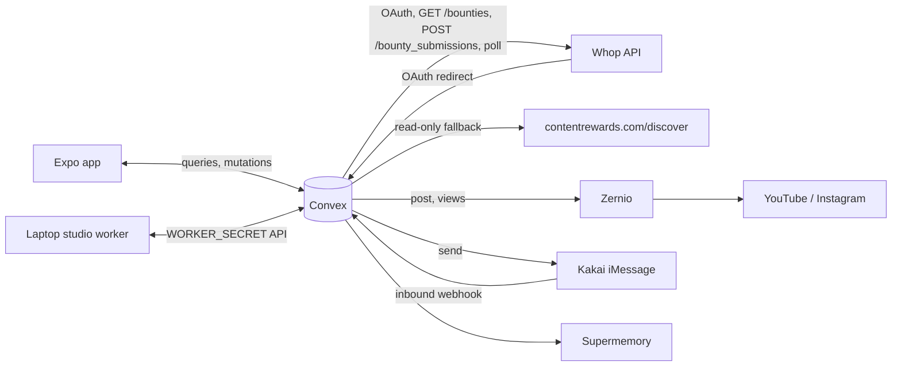

# BUILD_PLAN.md: Outpost build map for the Captain

Read order for any thread: this file, then `AGENTS.md`, then `BRIEF.md`, then `outpost/AGENTS.md`. This file is the
plan; `BRIEF.md` is the product; `AGENTS.md` is the rules and what is built today. If they disagree on product,
`BRIEF.md` wins. If they disagree on what exists, the code wins.

Written Sun Nov 15 2026, ~12:15 PT, at the YC Consumer Mobile Hackathon. Demo is tonight. Optimize for a working,
honest end-to-end demo over breadth.

---

## 1. Goal in one paragraph

Turn today's app (agents make original vertical videos, you swipe to post them to YouTube/Instagram) into the
brief: **get paid for your taste**. The user signs in with Whop, picks paid bounties in an in-app marketplace,
Outpost's studio makes videos for those bounties, the user swipes (left = kill/remake, chip = tweak, right =
approve), approved videos post to the user's social account through Zernio, the public post URL is submitted to
the Whop bounty automatically, and a scoreboard shows views, estimated pending earnings, review status and a taste
score. An agent texts the user over iMessage (Kakai) when clips are ready or blowing up.

## 2. Principle: one platform per job

| Job | Platform | Status |
|---|---|---|
| Backend, data, files, crons, webhooks | Convex | Built |
| AI (scripts, moment picking, rules parsing, agent) | Claude (`claude -p` in studio; Anthropic API from Convex only if needed) | Built (studio) |
| Video making | The existing laptop studio (`outpost/studio/`), extended | Built (original mode) |
| Posting + view counts | Zernio | Built (YouTube + Instagram) |
| Login, bounties, submissions, payouts | Whop official API (OAuth + Bounties) | Not built |
| iMessage agent | Kakai (sponsor) | Not built |
| Taste memory | Supermemory (already works) | Built |

Do NOT add: Ayrshare, Upload-Post, Apify, Playwright/browser agents, cookie capture of Whop sessions, yt-dlp view
polling, OpenShorts server, a second backend, a second LLM vendor. If a thread thinks it needs a new platform, it
stops and asks the Captain.

## 3. What exists today (verified by reading the repo)

- `outpost/src/`: Expo SDK 58 iOS app. Tabs: Base (pixel village, `Base.tsx`), Feed (`Feed.tsx`, 700 lines,
  swipe right = post, left = reason picker -> remake), You (`You.tsx`, streak, views). `/hood` = call log. App
  talks only to Convex, identity is a keychain `deviceId` (`session.tsx`, `device.ts`).
- `outpost/convex/`: 16 tables (`schema.ts`). Feed (`feed.ts`), studio job queue (`studio.ts`), Zernio posting
  with pacing and `dryRun/private/public` modes (`post.ts`, `pace.ts`), views every 20 min (`views.ts`), Whop
  product search "Scout" with no key (`scout.ts`), Whop sandbox shop raid (`raids.ts`, `whop.ts`), Supermemory
  (`memory.ts`), one HTTP route `POST /whop/webhook` (`http.ts`), 2 crons (`crons.ts`).
- `outpost/studio/`: laptop Node worker. `claude -p` writes a script (`reel.mjs` `SCRIPT_SCHEMA`), Kokoro voices
  it (`voice.py`), Compound renders it, MP4 uploads to Convex. macOS-only paths. Cannot run in a cloud sandbox.
- Not built: bounties, Whop login, submissions, clip mode, earnings, taste score, iMessage, TikTok, per-user
  social connect (today `admin.linkZernio` links the builder's Zernio accounts to a user by hand).

## 4. Facts about Whop (researched; cite these, don't re-research)

Two different Whop things exist. Do not confuse them.

**A. Whop Bounties API (official, documented).** `https://api.whop.com/api/v1`, sandbox
`https://sandbox-api.whop.com/api/v1`.
- `GET /bounties`: filters `status`, `business_goal_type` (`clipping`, `post_engagement`, `owned_account_growth`,
  `ugc_content`, `local_activation`, `data_capture`, `other`), `query`, `country`, `order`, cursor pagination
  (`first` max 100). Scope `bounty:basic:read`. With an account API key it lists only that account's own
  bounties; **with a user OAuth token it lists bounties the user can see and work**. So listing for a user needs
  the user's token.
- Fields: `id` (`bnty_`), `title`, `description`, `status`, `gross_reward_amount`, `net_reward_amount` (per
  accepted submission, whole currency units), `budget_amount`, `gross_paid_out_amount`, `spots_remaining`,
  `accepted_submissions_limit`, `accepted_submissions_per_user_limit`, `accepted_deliverable_types`
  (`content_url`, `media`, `data_capture`), `allowed_country_codes`, `poster`.
- `POST /bounty_submissions`: body `{ bounty_id, deliverable: { urls: [...], caption? } }`. **Requires a user
  OAuth token with scope `bounty:submission:create`; account API keys cannot submit.** Supports
  `Idempotency-Key`. With a deliverable it goes straight to review.
- Statuses: `in_progress`, `submitted`, `approved` (paid from escrow), `denied` (`denial_reason`).
- Approve/deny happens only in Whop's dashboard. **No webhooks for bounties: poll** `GET /bounty_submissions`.
- Reward is **flat per accepted submission**, not per view. No platform field on bounties.
- Docs: docs.whop.com/api-reference/bounties, docs.whop.com/developer/bounties/run-a-bounty-program

**B. Whop Content Rewards (contentrewards.com).** The big per-view clipping marketplace (~700 live campaigns,
$/1K views, budgets, min views, per-clip caps, 48h auto-approve, 7% fee, social account must be OAuth-linked to
the clipper's Whop account). Public board `contentrewards.com/discover` is server-rendered and readable without
login. **No public API to join or submit.** Almost every campaign on the board today is `Clipping` of footage
the brand provides; a few `UGC` (split-screen) and `Sound` campaigns.

**Open question (human is asking the Whop team at the event):** are Content Rewards campaigns exposed through
the Bounties API (as `business_goal_type=clipping`), and can a third-party OAuth app submit for a user? Until
answered, build against A (official API) and use B only as a read-only fallback list with a "submit on Whop"
deep link. Never scrape cookies or automate Whop's web UI.

## 5. Decisions (defaults so nobody blocks; Captain updates this table when humans answer)

| # | Decision | Default now | Changes if |
|---|---|---|---|
| D1 | Bounty source | Whop Bounties API via user OAuth (primary). Content Rewards board as read-only fallback with deep-link submit | Whop says Content Rewards is in the API (then fallback is dropped) |
| D2 | Video type | Two studio modes: `original` (today's pipeline, bounty-aware) and `clip` (cut provided footage). Bounty's mode decides | If chosen demo bounties are all one type, finish that mode first |
| D3 | Platforms | YouTube + Instagram via Zernio (works today). Add `tiktok` to the platform union now, wire it only if time allows | Human confirms Zernio TikTok views are usable |
| D4 | Accounts | Demo: builder-linked Zernio accounts (`admin.linkZernio`) on a real account with followers. Per-user Zernio connect is P2 | Time allows |
| D5 | Earnings model | Support both `per_submission` (flat, Bounties API) and `per_view` (Content Rewards) | n/a |
| D6 | iMessage | Kakai behind a `notify` provider interface; log-only provider until Kakai creds arrive | Kakai unavailable: Sendblue |
| D7 | Identity | Keep `deviceId`; add "Connect Whop" (OAuth) that attaches a Whop user + token to the device's user | n/a |

## 6. Architecture after this build



Life of a bounty video:
1. User taps Connect Whop -> Whop OAuth -> Convex HTTP callback stores token (server-only).
2. Cron `bounties.sync` lists open bounties with the user's token (+ fallback board). Rows in `bounties`.
3. User opens Bounties screen, taps Take -> `userBounties` row -> `refill` queues videos with `bountyId` and `mode`.
4. Studio `claim` returns bounty context (title, brand, rules, checklist, source URLs, mode). Worker runs `original`
   or `clip` pipeline, uploads MP4 (unchanged upload path).
5. Feed shows the bounty tag and reward. Right swipe -> existing `posts` rows -> Zernio -> post goes `live` with URL.
6. When a post on a bounty video goes `live`, schedule `submit.forPost` -> `POST /bounty_submissions` with the URL
   (Idempotency-Key = post id). Fallback source or no token -> submission row `manual` with a deep link.
7. Cron `submit.poll` updates statuses. `earnings.summary` computes pending/approved and taste score.
8. Cron `agent.tick` decides what to text (batch ready, spike, approved). Kakai sends. Inbound replies hit
   `POST /kakai/webhook`.

## 7. Contracts (Wave 1 lands these; everything else codes against them)

### 7.1 Schema additions (`convex/schema.ts`), all new fields optional on existing tables

```ts
export const platform = v.union(v.literal("youtube"), v.literal("instagram"), v.literal("tiktok"));

bounties: defineTable({
  source: v.union(v.literal("whop_bounty"), v.literal("content_rewards")),
  externalId: v.string(),                 // bnty_... or content rewards campaign id
  title: v.string(), brand: v.string(), description: v.string(),
  goalType: v.string(),                   // business_goal_type or CR category
  mode: v.union(v.literal("original"), v.literal("clip")),
  rewardKind: v.union(v.literal("per_submission"), v.literal("per_view")),
  rewardCents: v.optional(v.number()),    // per accepted submission (net)
  ratePer1kCents: v.optional(v.number()), // per 1K views
  minViews: v.optional(v.number()), maxPerClipCents: v.optional(v.number()),
  budgetCents: v.optional(v.number()), paidOutCents: v.optional(v.number()),
  spotsRemaining: v.optional(v.number()),
  rules: v.string(), checklist: v.optional(v.any()), sourceUrls: v.array(v.string()),
  url: v.string(), status: v.union(v.literal("open"), v.literal("closed")),
  syncedAt: v.number(),
}).index("by_source_external", ["source", "externalId"]).index("by_status", ["status"]),

userBounties: defineTable({
  userId: v.id("users"), bountyId: v.id("bounties"),
  status: v.union(v.literal("active"), v.literal("dropped")), takenAt: v.number(),
}).index("by_user", ["userId"]).index("by_user_bounty", ["userId", "bountyId"]),

submissions: defineTable({
  userId: v.id("users"), bountyId: v.id("bounties"), videoId: v.id("videos"), postId: v.id("posts"),
  url: v.string(), externalId: v.optional(v.string()), // btys_...
  status: v.union(v.literal("pending"), v.literal("submitted"), v.literal("approved"),
    v.literal("denied"), v.literal("manual"), v.literal("failed")),
  denialReason: v.optional(v.string()), error: v.optional(v.string()),
  submittedAt: v.optional(v.number()), resolvedAt: v.optional(v.number()), checks: v.number(),
}).index("by_post", ["postId"]).index("by_status", ["status"]).index("by_user", ["userId"]),

whopAuth: defineTable({ // server-only. No public function may return tokens.
  userId: v.id("users"), whopUserId: v.string(), username: v.optional(v.string()),
  accessToken: v.string(), refreshToken: v.optional(v.string()), expiresAt: v.number(), scopes: v.array(v.string()),
}).index("by_user", ["userId"]).index("by_whop_user", ["whopUserId"]),

oauthStates: defineTable({ state: v.string(), userId: v.id("users"), at: v.number() }).index("by_state", ["state"]),

messages: defineTable({
  userId: v.id("users"), direction: v.union(v.literal("out"), v.literal("in")),
  kind: v.string(), body: v.string(), providerId: v.optional(v.string()), at: v.number(),
}).index("by_user_at", ["userId", "at"]),

// users: add phone?: string, tasteScore?: number, baselineViews?: number
// videos: add bountyId?: Id<"bounties">, mode?: "original" | "clip",
//   clip?: { sourceUrl: string, startS: number, endS: number, hook: string, captionStyle: string }
```

### 7.2 Function signatures (stubs created in Wave 1, filled by owners)

| File (owner) | Function | Kind | Contract |
|---|---|---|---|
| `bounties.ts` (T2) | `list({deviceId})` | query | `[{id, title, brand, mode, rewardLabel, budgetLabel, spotsLabel, taken, source}]` open bounties, taken first |
| | `take({deviceId, bountyId})` / `drop(...)` | mutation | upsert `userBounties`, call `refill` |
| | `sync({})` | internal action | cron every 15 min |
| `whopAuth.ts` (T3) | `startUrl({deviceId})` | mutation | returns Whop authorize URL with stored `state` |
| | `status({deviceId})` | query | `{connected, username}` only |
| | `callback(req)` | used by HTTP route | exchange code, store token, redirect to `outpost://whop-connected` |
| | `tokenFor(userId)` | internal query | fresh token or null (refresh if expired) |
| `submit.ts` (T4) | `forPost({postId})` | internal action | create submission, idempotent |
| | `poll({})` | internal action | cron every 10 min, update statuses |
| | `forVideo({deviceId, videoId})` | query | status + deep link for UI |
| `earnings.ts` (T9) | `summary({deviceId})` | query | `{pendingCents, approvedCents, perVideo[], tasteScore, tasteTrend, settledCount}` |
| `agent.ts` (T10) | `tick({})` | internal action | cron every 5 min |
| | `inbound(req)` | used by HTTP route | Kakai webhook |
| `studio.ts` (T6) | `claim` | mutation | adds `bounty: {title, brand, mode, rules, checklist, sourceUrls}` and `clip` (for remakes) to its return |

HTTP routes (added in Wave 1 in `http.ts`): `GET /whop/oauth/callback` -> `whopAuth.callback`,
`POST /kakai/webhook` -> `agent.inbound`. Crons (added in Wave 1 in `crons.ts`): `bounties.sync` 15 min,
`submit.poll` 10 min, `agent.tick` 5 min. Stubs are no-ops that typecheck.

### 7.3 Env vars (Convex, server-only)

`WHOP_CLIENT_ID`, `WHOP_CLIENT_SECRET`, `WHOP_OAUTH_REDIRECT` (= `<PUBLIC_SITE_URL>/whop/oauth/callback`),
`WHOP_BOUNTY_ENV` (`sandbox` default | `production`), `KAKAI_API_KEY`, `KAKAI_FROM`, `ANTHROPIC_API_KEY`
(only if a Convex action needs Claude; prefer doing LLM work in the studio). Existing: `ZERNIO_API_KEY`,
`WHOP_API_KEY` (shop raid sandbox), `SUPERMEMORY_API_KEY`, `WORKER_SECRET`, `PUBLIC_SITE_URL`.

## 8. Workstreams (threads)

Waves: **Wave 0** humans now (unblocks real data). **Wave 1** one thread, contracts only, must merge before Wave 2.
**Wave 2** everything in parallel, each thread owns distinct files. **Wave 3** integration and demo.

Why this shape: `schema.ts`, `http.ts`, `crons.ts`, `_generated/` are shared files that every feature touches. If
ten threads edit them in parallel you get ten conflicting PRs. Wave 1 puts all shared edits plus no-op stubs in
one PR, so Wave 2 threads only touch files they own and merge independently.

### Wave 0: humans (Charlie + partner), start immediately, parallel to Wave 1

- H1. Ask the Whop team: (a) Content Rewards campaigns via `/bounties`? (b) third-party OAuth app can call
  `POST /bounty_submissions` for a user? (c) sandbox bounties to test with? (d) can they create 2-3 demo bounties
  for us? Update D1.
- H2. Create the Whop OAuth app (client id/secret, redirect `<PUBLIC_SITE_URL>/whop/oauth/callback`, scopes
  `bounty:basic:read`, `bounty:submission:create`, plus user identity). Set env vars.
- H3. Get Kakai API access/docs and a sending number. Set env vars. Paste the API shape into
  `outpost/docs/integrations.md` for T10.
- H4. Pick the demo: 2-3 real bounties (note mode: original vs clip), a real social account with followers
  linked in Zernio and on Whop. Post a couple of real videos ASAP so views exist by demo time.
- H5. Confirm Zernio TikTok view freshness if you want TikTok (D3). Otherwise stay YouTube + Instagram.
- H6. Keep the studio worker running on the laptop. Only humans run the studio and iOS builds.

### Wave 1

**T1. Contracts and scaffolding** (blocks Wave 2; keep it small, merge fast)
- Owns: `convex/schema.ts`, `convex/http.ts`, `convex/crons.ts`, new stub files `bounties.ts`, `whopAuth.ts`,
  `submit.ts`, `earnings.ts`, `agent.ts`, `notify.ts`, `convex/_generated/*`, `outpost/docs/contracts.md`.
- Do: add everything in section 7 exactly. Stubs return empty/no-op values with correct types. Add `tiktok` to
  the platform union without adding it to `PLATFORMS` in `lib.ts`. Add `bounties` to `SERVICES` in `hood.ts`
  for Whop Bounties and Kakai (status "waiting on its key").
- Done when: three CI checks pass, `_generated` committed, contracts doc lists every signature.

### Wave 2 (all parallel after T1 merges)

**T2. Bounty sync + marketplace backend** (P0)
- Owns: `convex/bounties.ts`.
- Do: `sync` lists `GET /bounties?status=open` per connected user (token from `whopAuth.tokenFor`), filter
  `accepted_deliverable_types` includes `content_url`, map to `bounties` (mode: `clip` if goal type `clipping`,
  else `original`; `rewardKind: per_submission`, `rewardCents` from `net_reward_amount`). Use
  `Api-Version-Date` header and sandbox base when `WHOP_BOUNTY_ENV != production`. Fallback provider: read
  `contentrewards.com/discover` server-rendered data (no login), map to `per_view`, `source: content_rewards`,
  read-only. Mark missing bounties `closed`. `list`, `take`, `drop` per contract. `take` sets `bountyId`/`mode`
  on the refill (coordinate: `refill` lives in `lib.ts`; T2 owns adding an optional bounty-aware branch to
  `refill`, nobody else edits `lib.ts`).
- Admin: `admin.seedBounties` internal mutation (in `bounties.ts`, not `admin.ts`) that inserts hand-written demo
  bounties, so the demo never depends on the network.
- Log every Whop call to `calls`. Never log tokens.
- Done when: seeded and synced bounties appear via `list`; `take` queues bounty videos.

**T3. Whop OAuth** (P0, on critical path)
- Owns: `convex/whopAuth.ts`, `src/WhopConnect.tsx` (new), the connect entry point on the You tab (single
  line added to `You.tsx` render; coordinate with T9 by adding it as a self-contained component).
- Do: OAuth authorization code flow (with PKCE if Whop supports it). `startUrl` stores `state`; app opens it with
  `expo-web-browser` `openAuthSessionAsync` (already installed); HTTP callback exchanges the code at Whop's token
  endpoint, stores token, redirects to the app scheme. Refresh in `tokenFor`. Check Whop OAuth docs
  (docs.whop.com) for exact endpoints; don't guess.
- Done when: a device can connect and `status` returns the username; token never leaves Convex.

**T4. Submission** (P0)
- Owns: `convex/submit.ts`, plus one hook in `convex/post.ts` (`settle`, when a post goes `live` and its video has
  `bountyId`, schedule `submit.forPost`). Nobody else edits `post.ts`.
- Do: `forPost`: skip unless post `mode == public` (dryRun/private never submit). If bounty source
  `whop_bounty` and user has token: `POST /bounty_submissions` `{bounty_id, deliverable: {urls: [url], caption}}`
  with `Idempotency-Key = postId`, store `btys_` id, status `submitted`. Else status `manual` with deep link to
  the bounty/campaign URL. `poll`: list the user's submissions, map statuses, set `resolvedAt`,
  `denialReason`. Retry 429/5xx up to 3x.
- Hard rule: threads and tests never submit to real bounties; sandbox only unless the builder flips env.
- Done when: a live post on a sandbox bounty produces a submission row that progresses on poll.

**T5. Studio clip mode** (P0 if demo bounties are clipping, else P1)
- Owns: `studio/clip.mjs` (new), the mode switch in `studio/worker.mjs` (only this thread edits `worker.mjs`).
- Do: for `mode == clip`: download source (`yt-dlp`, cached per URL in `/tmp/outpost/sources`), transcribe with
  word timestamps (local `whisper.cpp` or `mlx-whisper`; pick whichever installs in one command on the laptop),
  `claude -p --json-schema` picks 1 moment per job `{startS, endS, hook, captionStyle, why}` respecting the
  checklist, `ffmpeg` cuts, reframes to 1080x1920 (center crop with blurred background fill is fine), burns
  word-level captions (ASS) and a hook title for the first 3s. Upload through the existing `uploadUrl`/`finish`.
  Remakes for clip mode change only clip params and re-render (seconds, no re-download).
- Mechanical steps in code, LLM only for picking moments and hooks. No AGPL code.
- Verification in cloud: `node --check studio/worker.mjs studio/clip.mjs` only. Say in the PR it was not run.
  Humans run it on the laptop.
- Done when: humans see a captioned 9:16 clip from a bounty source in the Feed.

**T6. Bounty-aware original mode + claim context** (P0, fastest path to a real demo)
- Owns: `convex/studio.ts` (`claim`), `studio/reel.mjs` (prompt `system()` and schema).
- Do: `claim` returns `bounty` context and `clip` params per contract. In original mode the writer gets the
  bounty title, brand, description and checklist and must satisfy it (required mentions, hashtags, CTA, length).
  Keep the "Made with AI." disclosure and all existing remake behavior.
- Done when: a video queued for a bounty is visibly about that bounty and its caption meets the checklist.

**T7. Bounties screen** (P0)
- Owns: `src/Bounties.tsx` (new), `src/app/bounties.tsx` (new route) or a new tab via `src/app/(tabs)/` +
  `TabBar.tsx` (T7 is the only thread editing `TabBar.tsx` and `(tabs)/_layout.tsx`).
- Do: list from `bounties.list`: brand, title, reward ("$X per approved post" or "$Y / 1K views"), budget or
  spots left, mode badge, Take/Taken button. Empty state with Connect Whop (render T3's component). Match the
  pixel art style (`pixel.tsx`, Jersey fonts). Keep `testID`s.
- Done when: user can browse and take a bounty from the phone.

**T8. Feed upgrades** (P0)
- Owns: `src/Feed.tsx`, `convex/feed.ts`.
- Do: `next` adds `bounty: {brand, rewardLabel}` per card; card shows a bounty tag. Edit chips on the card
  (map to existing `REASONS` remake keys: "Punchier hook" -> `hook`, "Shorter" -> `long`, "New look" ->
  `visuals`, plus free note -> `more`). Keep left-swipe reasons. Right swipe unchanged except copy:
  "Posting + submitting to <brand>". Mix cards across taken bounties by `rank`.
- Done when: Feed shows bounty cards with chips; chips queue remakes that come back within a few cards.

**T9. Scoreboard, earnings, taste score** (P0)
- Owns: `convex/earnings.ts`, `convex/you.ts`, `src/You.tsx`, `src/Hud.tsx`, `src/Payoff.tsx`.
- Do: per bounty video:
  - `per_submission`: pending = `rewardCents` when `submitted`; approved when `approved`; 0 when `denied`.
  - `per_view`: 0 below `minViews`, else `min(views/1000 * ratePer1kCents, maxPerClipCents)`.
  - Label everywhere: "Estimated, not guaranteed, pending Whop review."
  - Taste score 0-100 = scale(approvalRate x performance). approvalRate = approved / settled submissions.
    performance = median views of the user's bounty posts at 48h / `baselineViews` (baseline = median of the
    account's earlier posts; seed from existing `posts.views`). Before anything settles, show "calibrating"
    plus a provisional score from approvals per swipe ratio (selectivity) so it isn't empty. Trend arrow vs 24h ago.
  - HUD top bar: total views, pending $, taste score. You tab: per-video status list.
- Done when: numbers render from real rows and match the formulas.

**T10. iMessage agent** (P1)
- Owns: `convex/agent.ts`, `convex/notify.ts`.
- Do: `notify.send(userId, kind, body)` with provider = Kakai when keys exist, else log-only (writes `messages` +
  `calls`). `agent.tick` checks: new ready batch for a taken bounty ("6 new clips for <brand>, swipe?"), view spike
  (post views >= 3x baseline within 2h: "our clip is blowing up" + URL), submission approved ("<brand> approved
  your clip, +$X"). Dedupe per event. Max 3 texts/user/day. `inbound`: parse replies like "more like that",
  "skip <brand>" into taste notes (reuse `memory` flow via scheduling, don't edit `memory.ts`). Admin
  `agent.sendTest` internal for the demo.
- Done when: log-only provider records correct messages; with Kakai keys a real text arrives.

**T11. Docs + hood + demo runbook** (P1, can start right after T1)
- Owns: `outpost/docs/*`, `README.md`, root `AGENTS.md` status table, `convex/hood.ts` (after T1's edit).
- Do: describe new flows as they merge; update status table honestly; extend the demo runbook for Wave 3.

**T12. Per-user social connect via Zernio** (P2)
- Owns: `convex/connect.ts` (new), `src/Connect.tsx` (new).
- Do: Zernio's hosted connect flow per user/profile (check Zernio docs), replace `admin.linkZernio` for new users.
  Only if P0 is done.

**T13. Sponsor proof: Revyl device test + Capy PR proof** (P2)
- Owns: `.revyl/` or test YAML, CI additions. Only if P0 is done.

### Wave 3: integration (Captain + humans)

1. Merge order for conflicts: T1 -> (T3, T2) -> T6 -> T8 -> T7 -> T4 -> T9 -> T5 -> T10 -> rest.
2. End-to-end on the laptop + phone with sandbox bounties: connect Whop -> take bounty -> studio makes video ->
   swipe right -> post (private first, then public on the demo account) -> submission row -> poll -> scoreboard.
3. Seed demo state: `admin.seedBounties`, pre-generate ~15 videos, at least a few real public posts from this
   morning so views and pending $ are real.
4. Feature freeze 2 hours before demos. After that, only fixes and the runbook.

## 9. Critical path and dependencies

```
H2 (Whop OAuth app) ─┐
T1 ──> T3 (OAuth) ──> T2 (bounty sync) ──> T7 (screen) ─┐
          │                └─> T6 (claim ctx) ──> studio makes bounty videos ──> T8 (feed) ──> post (exists)
          └──────────────> T4 (submit) <─────────────────────────────────────────────────────┘
T4 + views (exists) ──> T9 (earnings/taste) ──> T10 (texts)
T5 (clip mode) is parallel and only gates clipping bounties.
```

If OAuth or the Bounties API stalls: `admin.seedBounties` + Content Rewards read-only list keep T7/T8/T6/T9
moving, and submissions fall back to `manual` deep links. The demo still works end to end except the
auto-submit, which is shown as one tap.

## 10. Rules for every thread (in addition to AGENTS.md hard rules)

- Edit only files your thread owns. Need a change elsewhere? Ask the Captain; the owner makes it.
- Never commit secrets or tokens. Tokens live only in `whopAuth` and never in a public query result or `calls`.
- Never post publicly, submit to real bounties, or flip `postingMode`/`WHOP_BOUNTY_ENV` from a thread or test.
- Every outside call goes through a Convex action and is logged to `calls`.
- Don't guess external APIs: read the docs pages named here; if a doc doesn't answer, write the assumption in the
  PR and flag it.
- PR must pass the three CI checks and state what was verified and what was not (studio and iOS are not runnable
  in the cloud; say so).
- Agents may merge their PRs once CI is green, following the merge order in Wave 3. Never push directly to `main`.

## 11. Known unknowns (track, don't pretend)

| Unknown | Owner | Impact |
|---|---|---|
| Content Rewards in Bounties API? Third-party submit allowed? | H1 | D1, T2, T4 |
| Whop OAuth endpoints, PKCE, scope names for identity | T3 + H2 | T3 |
| How many open `content_url` bounties exist for a normal user | H1/T2 | Marketplace may be thin; seed demo bounties |
| Do clipping bounties provide downloadable source footage | H4 | T5 |
| Kakai API shape | H3 | T10 |
| Zernio TikTok analytics freshness | H5 | D3 |
| Whether bounties reject AI-made or AI-edited content | H1 | Which bounties to show; disclosure stays on |
