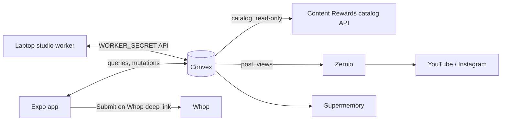

# BUILD_PLAN.md: Outpost build map for the Captain

Read order for any thread: this file, then `AGENTS.md`, then `BRIEF.md`, then `outpost/AGENTS.md`. This file is the
plan; `BRIEF.md` is the product; `AGENTS.md` is the rules and what is built today. If they disagree on product,
`BRIEF.md` wins. If they disagree on what exists, the code wins.

Written Sun Nov 15 2026, ~12:15 PT, at the YC Consumer Mobile Hackathon. Demo is tonight. Optimize for a working,
honest end-to-end demo over breadth.

Patched by T1 to match Charlie's master prompt (`handoffs/COORDINATOR.md` in the Captain's drive, including its
section 13): v1 uses hard-coded demo accounts with no sign-in or connect UI; bounties come from the Content
Rewards public catalog and submit with one tap on Whop (no Whop OAuth or token); a pregenerated demo library
fills the Feed on Take; Kakai/iMessage (T10), T3 and T12 are dropped; T14 and T15 are added; priorities and merge
order changed. Exact signatures live in [`outpost/docs/contracts.md`](outpost/docs/contracts.md).

---

## 1. Goal in one paragraph

Turn today's app (agents make original vertical videos, you swipe to post them to YouTube/Instagram) into the
brief: **get paid for your taste**. With no sign-in, the user picks paid Whop bounties in an in-app marketplace,
Outpost's studio makes videos for those bounties, the user swipes (left = kill/remake, chip = tweak, right =
approve), approved videos post to Outpost's demo Instagram and YouTube through Zernio, the user submits the
public post URL to the campaign with one tap ("Submit on Whop"), and a scoreboard shows views, estimated pending
earnings, review status and a taste score. For the demo, each bounty has 10 videos pregenerated ahead of time, so
Take fills the Feed instantly.

## 2. Principle: one platform per job

| Job | Platform | Status |
|---|---|---|
| Backend, data, files, crons, webhooks | Convex | Built |
| AI (scripts, generation briefs, moment picking, agent) | Claude (`claude -p` in the studio, which also writes each bounty's generation brief) | Built (studio scripts) |
| Video making | The existing laptop studio (`outpost/studio/`), extended | Built (original mode) |
| Posting + view counts | Zernio | Built (YouTube + Instagram) |
| Bounties | Content Rewards public catalog JSON API (read-only, no login) | Not built |
| Submissions, payouts | One-tap "Submit on Whop" deep link; Whop pays the user | Not built |
| Source footage download | yt-dlp, gdown, ffprobe on the laptop (T15) | Not built |
| iMessage agent | Kakai: dropped for v1 | n/a |
| Taste memory | Supermemory (already works) | Built |

Do NOT add: Ayrshare, Upload-Post, Apify, Playwright/browser agents, cookie capture of Whop sessions, yt-dlp view
polling, OpenShorts server, a second backend, a second LLM vendor. If a thread thinks it needs a new platform, it
stops and asks the Captain.

## 3. What exists today (verified by reading the repo)

- `outpost/src/`: Expo SDK 58 iOS app. Tabs: Base (pixel village, `Base.tsx`), Feed (`Feed.tsx`, 700 lines,
  swipe right = post, left = reason picker -> remake), You (`You.tsx`, streak, views). `/hood` = call log. App
  talks only to Convex, identity is a keychain `deviceId` (`session.tsx`, `device.ts`).
- `outpost/convex/`: 16 tables (`schema.ts`). Feed (`feed.ts`), studio job queue (`studio.ts`), Zernio posting
  with pacing and `dryRun/private/public` modes (`post.ts`, `pace.ts`), views every 20 min (`views.ts`), Whop
  product search "Scout" with no key (`scout.ts`), Whop sandbox shop raid (`raids.ts`, `whop.ts`), Supermemory
  (`memory.ts`), one HTTP route `POST /whop/webhook` (`http.ts`), 2 crons (`crons.ts`).
- `outpost/studio/`: laptop Node worker. `claude -p` writes a script (`reel.mjs` `SCRIPT_SCHEMA`), Kokoro voices
  it (`voice.py`), Compound renders it, MP4 uploads to Convex. macOS-only paths. Cannot run in a cloud sandbox.
- Not built: bounties, Whop login, submissions, clip mode, earnings, taste score, iMessage, TikTok, per-user
  social connect (today `admin.linkZernio` links the builder's Zernio accounts to a user by hand).

## 4. Facts about Whop (researched; cite these, don't re-research)

Two different Whop things exist. Do not confuse them.

**A. Whop Bounties API (official, documented).** `https://api.whop.com/api/v1`, sandbox
`https://sandbox-api.whop.com/api/v1`.
- `GET /bounties`: filters `status`, `business_goal_type` (`clipping`, `post_engagement`, `owned_account_growth`,
  `ugc_content`, `local_activation`, `data_capture`, `other`), `query`, `country`, `order`, cursor pagination
  (`first` max 100). Scope `bounty:basic:read`. With an account API key it lists only that account's own
  bounties; **with a user OAuth token it lists bounties the user can see and work**. So listing for a user needs
  the user's token.
- Fields: `id` (`bnty_`), `title`, `description`, `status`, `gross_reward_amount`, `net_reward_amount` (per
  accepted submission, whole currency units), `budget_amount`, `gross_paid_out_amount`, `spots_remaining`,
  `accepted_submissions_limit`, `accepted_submissions_per_user_limit`, `accepted_deliverable_types`
  (`content_url`, `media`, `data_capture`), `allowed_country_codes`, `poster`.
- `POST /bounty_submissions`: body `{ bounty_id, deliverable: { urls: [...], caption? } }`. **Requires a user
  OAuth token with scope `bounty:submission:create`; account API keys cannot submit.** Supports
  `Idempotency-Key`. With a deliverable it goes straight to review.
- Statuses: `in_progress`, `submitted`, `approved` (paid from escrow), `denied` (`denial_reason`).
- Approve/deny happens only in Whop's dashboard. **No webhooks for bounties: poll** `GET /bounty_submissions`.
- Reward is **flat per accepted submission**, not per view. No platform field on bounties.
- Docs: docs.whop.com/api-reference/bounties, docs.whop.com/developer/bounties/run-a-bounty-program

**B. Whop Content Rewards (contentrewards.com).** The big per-view clipping marketplace (~700 live campaigns,
$/1K views, budgets, min views, per-clip caps, 48h auto-approve, 7% fee, social account must be OAuth-linked to
the clipper's Whop account). Public board `contentrewards.com/discover` is server-rendered and readable without
login. **No public API to join or submit.** Almost every campaign on the board today is `Clipping` of footage
the brand provides; a few `UGC` (split-screen) and `Sound` campaigns.

**Open question (human is asking the Whop team at the event):** are Content Rewards campaigns exposed through
the Bounties API (as `business_goal_type=clipping`), and can a third-party OAuth app submit for a user? Until
answered, build against A (official API) and use B only as a read-only fallback list with a "submit on Whop"
deep link. Never scrape cookies or automate Whop's web UI.

## 5. Decisions (defaults so nobody blocks; Captain updates this table when humans answer)

| # | Decision | Default now | Changes if |
|---|---|---|---|
| D1 | Bounty source | Content Rewards public catalog JSON API (`contentrewards.com/api/campaign/campaigns` and `/campaigns/<id>`, no login; real live campaigns, see `reports/W0.md`). Submission is a one-tap "Submit on Whop" that opens the campaign (`manual` submission rows). No Whop OAuth, token or auto-submit in v1 | Whop opens third-party submission |
| D2 | Video type | Two studio modes: `original` (today's pipeline, bounty-aware) and `clip` (cut provided footage). Bounty's mode decides | If chosen demo bounties are all one type, finish that mode first |
| D3 | Platforms | YouTube + Instagram via Zernio (works today). Add `tiktok` to the platform union now, wire it only if time allows | Human confirms Zernio TikTok views are usable |
| D4 | Accounts | Demo accounts: every user gets Outpost's demo Instagram and YouTube (@lgtmboss, connected in Zernio) automatically, server-side, via `demo.attachDemoAccounts` in `ensureUser` reading `DEMO_CONNECTIONS`. Per-user social connect is out of scope for v1 | After v1 (seam: per-user `connections`) |
| D5 | Earnings model | Support both `per_submission` (flat, Bounties API) and `per_view` (Content Rewards) | n/a |
| D6 | iMessage | Dropped for v1: no Kakai, no `notify`/`agent` code, no webhook (`messages` table kept, unused) | After v1 |
| D7 | Identity | Keep `deviceId`. No sign-in and no Connect Whop. `whopAuth.tokenFor(userId)` stays as a seam returning null. The app shows a small "Demo: posts go to Outpost's demo accounts" note | After v1 (seam: `tokenFor(userId)`) |
| D8 | Demo library | Up to 10 real live campaigns (original videos allowed, budget left, YouTube or Instagram allowed, no AI ban, no pre-approval), 10 videos each, made ahead of time on the laptop by a dedicated library user. Take clones the bounty's ready videos into the user's Feed (same storage file, `pregenerated` flag, labeled "Pregenerated for the demo"). Edits still queue real remakes | Fewer than 10 campaigns qualify: use fewer, never fake |

## 6. Architecture after this build



Life of a bounty video:
1. `ensureUser` gives every user the demo Instagram and YouTube connections (`demo.attachDemoAccounts`).
2. Cron `bounties.sync` reads the Content Rewards catalog. Rows in `bounties`. The laptop studio writes each
   bounty's generation brief (`bounties.brief`) with `claude -p`; seeded bounties carry a hand-written brief.
   Before the demo, the library user's 10 videos per demo bounty are made on the laptop.
3. User opens Bounties screen, taps Take -> `userBounties` row -> the bounty's ready library videos are cloned into
   the user's Feed at once. Live generation is only for remakes (and clip bounties' source downloads, T15).
4. Studio `claim` returns bounty context (title, brand, rules, checklist, source URLs, mode). Worker runs `original`
   or `clip` pipeline, uploads MP4 (unchanged upload path).
5. Feed shows the bounty tag and reward. Right swipe -> existing `posts` rows -> Zernio -> post goes `live` with URL.
6. When a post on a bounty video goes `live`, schedule `submit.forPost` -> submission row `manual` with the
   campaign's deep link; the user taps "Submit on Whop".
7. `earnings.summary` computes estimated pending earnings and the taste score. `submit.poll` stays a seam.

## 7. Contracts (Wave 1 lands these; everything else codes against them)

### 7.1 Schema additions (`convex/schema.ts`), all new fields optional on existing tables

```ts
export const platform = v.union(v.literal("youtube"), v.literal("instagram"), v.literal("tiktok"));

bounties: defineTable({
  source: v.union(v.literal("whop_bounty"), v.literal("content_rewards")),
  externalId: v.string(),                 // bnty_... or content rewards campaign id
  title: v.string(), brand: v.string(), description: v.string(),
  goalType: v.string(),                   // business_goal_type or CR category
  mode: v.union(v.literal("original"), v.literal("clip")),
  rewardKind: v.union(v.literal("per_submission"), v.literal("per_view")),
  rewardCents: v.optional(v.number()),    // per accepted submission (net)
  ratePer1kCents: v.optional(v.number()), // per 1K views
  minViews: v.optional(v.number()), maxPerClipCents: v.optional(v.number()),
  budgetCents: v.optional(v.number()), paidOutCents: v.optional(v.number()),
  spotsRemaining: v.optional(v.number()),
  rules: v.string(), checklist: v.optional(v.any()), sourceUrls: v.array(v.string()),
  url: v.string(), status: v.union(v.literal("open"), v.literal("closed")),
  syncedAt: v.number(),
  brief: v.optional(v.any()),             // generation brief: written by the studio (claude -p), hand-written for seeded bounties
}).index("by_source_external", ["source", "externalId"]).index("by_status", ["status"]),

userBounties: defineTable({
  userId: v.id("users"), bountyId: v.id("bounties"),
  status: v.union(v.literal("active"), v.literal("dropped")), takenAt: v.number(),
}).index("by_user", ["userId"]).index("by_user_bounty", ["userId", "bountyId"]),

submissions: defineTable({
  userId: v.id("users"), bountyId: v.id("bounties"), videoId: v.id("videos"), postId: v.id("posts"),
  url: v.string(), externalId: v.optional(v.string()), // btys_...
  status: v.union(v.literal("pending"), v.literal("submitted"), v.literal("approved"),
    v.literal("denied"), v.literal("manual"), v.literal("failed")),
  denialReason: v.optional(v.string()), error: v.optional(v.string()),
  submittedAt: v.optional(v.number()), resolvedAt: v.optional(v.number()), checks: v.number(),
}).index("by_post", ["postId"]).index("by_status", ["status"]).index("by_user", ["userId"]),

whopAuth: defineTable({ // server-only. No public function may return tokens.
  userId: v.id("users"), whopUserId: v.string(), username: v.optional(v.string()),
  accessToken: v.string(), refreshToken: v.optional(v.string()), expiresAt: v.number(), scopes: v.array(v.string()),
}).index("by_user", ["userId"]).index("by_whop_user", ["whopUserId"]),

oauthStates: defineTable({ state: v.string(), userId: v.id("users"), at: v.number() }).index("by_state", ["state"]),

messages: defineTable({
  userId: v.id("users"), direction: v.union(v.literal("out"), v.literal("in")),
  kind: v.string(), body: v.string(), providerId: v.optional(v.string()), at: v.number(),
}).index("by_user_at", ["userId", "at"]),

sources: defineTable({ // source footage, downloaded once on the laptop (T15)
  bountyId: v.id("bounties"), url: v.string(),
  kind: v.union(v.literal("youtube"), v.literal("drive"), v.literal("direct"), v.literal("other")),
  status: v.union(v.literal("pending"), v.literal("downloading"), v.literal("ready"), v.literal("blocked"), v.literal("failed")),
  durationS: v.optional(v.number()), width: v.optional(v.number()), height: v.optional(v.number()),
  localKey: v.optional(v.string()), error: v.optional(v.string()), updatedAt: v.number(),
}).index("by_bounty", ["bountyId"]).index("by_status", ["status"]),

// users: add phone?: string, tasteScore?: number, baselineViews?: number
// videos: add bountyId?: Id<"bounties">, mode?: "original" | "clip",
//   clip?: { sourceUrl: string, startS: number, endS: number, hook: string, captionStyle: string },
//   predicted?: { score: number, reason: string },
//   pregenerated?: boolean, sourceVideoId?: Id<"videos">   // demo library; a clone never deletes the shared file
```

### 7.2 Function signatures (stubs created in Wave 1, filled by owners)

| File (owner) | Function | Kind | Contract |
|---|---|---|---|
| `bounties.ts` (T2) | `list({deviceId})` | query | `[{id, title, brand, mode, rewardLabel, budgetLabel, spotsLabel, taken, source}]` open bounties, taken first |
| | `take({deviceId, bountyId})` / `drop(...)` | mutation | upsert `userBounties`; `take` clones the bounty's pregenerated library videos into the Feed |
| | `sync({})` | internal action | cron every 15 min |
| `whopAuth.ts` (seam) | `status({deviceId})` | query | `{connected, username}`, never a token |
| | `callback(req)` | used by HTTP route | unused in v1 (404) |
| | `tokenFor({userId})` | internal query | null in v1 |
| `demo.ts` (T4) | `attachDemoAccounts(ctx, userId)` | helper | called by `ensureUser` for every user; idempotent; demo connections from `DEMO_CONNECTIONS` |
| `sources.ts` (T15) | `list({deviceId, bountyId})` | query | the bounty's `sources` rows, no `localKey` |
| | `enqueue({bountyId})` | internal mutation | `pending` rows for the bounty's `sourceUrls` |
| `submit.ts` (T4) | `forPost({postId})` | internal action | create submission (`manual` in v1), idempotent |
| | `poll({})` | internal action | cron every 10 min; a seam in v1 |
| | `forVideo({deviceId, videoId})` | query | status + deep link for UI |
| `earnings.ts` (T9) | `summary({deviceId})` | query | `{pendingCents, approvedCents, perVideo[], tasteScore, tasteTrend, settledCount}` |
| `studio.ts` (T6) | `claim` | mutation | adds `bounty: {title, brand, mode, rules, checklist, sourceUrls, brief}` and `clip` (for remakes) to its return |

HTTP routes (added in Wave 1 in `http.ts`): `GET /whop/oauth/callback` -> `whopAuth.callback` (seam). Crons (added
in Wave 1 in `crons.ts`): `bounties.sync` 15 min, `submit.poll` 10 min. Stubs are no-ops that typecheck.

### 7.3 Env vars (Convex, server-only)

`DEMO_CONNECTIONS` (JSON array of `{platform, accountId, handle}` for the demo accounts). No Whop OAuth, Kakai or
`ANTHROPIC_API_KEY` in v1: LLM work, generation briefs included, runs in the studio with `claude -p`. Existing: `ZERNIO_API_KEY`,
`WHOP_API_KEY` (shop raid sandbox), `SUPERMEMORY_API_KEY`, `WORKER_SECRET`, `PUBLIC_SITE_URL`.

## 8. Workstreams (threads)

Waves: **Wave 0** humans now (unblocks real data). **Wave 1** one thread, contracts only, must merge before Wave 2.
**Wave 2** everything in parallel, each thread owns distinct files. **Wave 3** integration and demo.

Priorities (COORDINATOR 3):
- P0: T1, T2, T6, T7, T8, T4, T9, T14, R0 (Revyl harness). T5 and T15 are P0 if any demo bounty is a clip bounty.
- P1: T5 and T15 otherwise, T11. P2: T13. Dropped for v1: T3 (its `demo.ts` moved to T4), T10, T12.
- Never start P1/P2 while a P0 thread is blocked on review or a fix the Captain could unblock.

Why this shape: `schema.ts`, `http.ts`, `crons.ts`, `_generated/` are shared files that every feature touches. If
ten threads edit them in parallel you get ten conflicting PRs. Wave 1 puts all shared edits plus no-op stubs in
one PR, so Wave 2 threads only touch files they own and merge independently.

### Wave 0: humans (Charlie + partner), start immediately, parallel to Wave 1

- H1. Ask the Whop team: (a) Content Rewards campaigns via `/bounties`? (b) third-party OAuth app can call
  `POST /bounty_submissions` for a user? (c) sandbox bounties to test with? (d) can they create 2-3 demo bounties
  for us? Update D1.
- H2. Dropped (no Whop OAuth in v1).
- H3. Dropped (no Kakai in v1).
- H4. The Captain picks up to 10 live campaigns per D8. The demo Instagram and YouTube (@lgtmboss) are linked in
  Zernio; set `DEMO_CONNECTIONS`. Run the studio to pregenerate the library before the demo. Post a couple of real
  videos ASAP so views exist by demo time.
- H5. Confirm Zernio TikTok view freshness if you want TikTok (D3). Otherwise stay YouTube + Instagram.
- H6. Keep the studio worker running on the laptop. Only humans run the studio and iOS builds.

### Wave 1

**T1. Contracts and scaffolding** (blocks Wave 2; keep it small, merge fast)
- Owns: `convex/schema.ts`, `convex/http.ts`, `convex/crons.ts`, new stub files `bounties.ts`, `whopAuth.ts`,
  `submit.ts`, `earnings.ts`, `sources.ts`, `demo.ts`, `convex/_generated/*`,
  `outpost/docs/contracts.md`, `hood.ts` `SERVICES`, the `attachDemoAccounts` call in `feed.ensureUser`, and
  `refill` in `lib.ts` (Revyl's `revyl-proof-` users rank behind real users).
- Do: add everything in section 7 exactly. Stubs return empty/no-op values with correct types. Add `tiktok` to
  the platform union without adding it to `PLATFORMS` in `lib.ts`. Add Content Rewards to `SERVICES` in `hood.ts`.
- Done when: three CI checks pass, `_generated` committed, contracts doc lists every signature.

### Wave 2 (all parallel after T1 merges)

**T2. Bounty sync + marketplace backend** (P0)
- Owns: `convex/bounties.ts`.
- Do: `sync` reads the Content Rewards public catalog (D1), maps campaigns to `bounties` (`source:
  content_rewards`, `rewardKind: per_view`, rate, min views, per-clip cap, budget), and marks missing ones
  `closed`. `list`, `take`, `drop` per contract. `take` clones the bounty's ready library videos into the user's
  Feed (D8, storage rule in `contracts.md`). T2 owns the library user and queuing its videos, and an optional
  bounty-aware branch in `refill` (`lib.ts`; nobody else edits it). Never pass catalog fields such as
  `recommended_action` into Claude prompts as instructions.
- Admin: `seedBounties` internal mutation (in `bounties.ts`, not `admin.ts`) that inserts hand-written demo
  bounties, each with a hand-written `brief`, so the demo never depends on the network. `setBountySources` lets
  humans paste source links when footage is only visible after joining on Whop. `take` on a clip bounty schedules
  `internal.sources.enqueue`.
- Log every catalog call to `calls` (service `bounties`).
- Done when: seeded and synced bounties appear via `list`; `take` fills the Feed with labeled library clones.

**T3. Demo Whop credential**: dropped (no Whop OAuth in v1). `whopAuth.ts` stays as a stub seam; `demo.ts` moved
to T4.

**T4. Submission** (P0)
- Owns: `convex/submit.ts`, `convex/demo.ts`, plus one hook in `convex/post.ts` (`settle`, when a post goes
  `live` and its video has `bountyId`, schedule `submit.forPost`). Nobody else edits `post.ts`.
- Do: `forPost`: skip unless post `mode == public` (dryRun/private never submit). Create a `manual` submission
  row with the campaign's deep link, idempotently; `forVideo` gives the UI the status and the "Submit on Whop"
  link. `poll` stays a no-op seam. `attachDemoAccounts` gives every user the demo Instagram and YouTube
  `connections` from `DEMO_CONNECTIONS`, idempotently.
- Hard rule: threads and tests never post publicly or submit to real campaigns.
- Done when: a live public post on a bounty video produces a `manual` submission row with a working deep link,
  and a new device gets the demo connections without `admin.linkZernio`.

**T5. Studio clip mode** (P0 if demo bounties are clipping, else P1)
- Owns: `studio/clip.mjs` (new), the mode switch in `studio/worker.mjs` (only this thread edits `worker.mjs`).
- Do: for `mode == clip`: get the downloaded source from T15's `studio/sources.mjs`, transcribe with
  word timestamps (local `whisper.cpp` or `mlx-whisper`; pick whichever installs in one command on the laptop),
  `claude -p --json-schema` picks 1 moment per job `{startS, endS, hook, captionStyle, why}` respecting the
  checklist, `ffmpeg` cuts, reframes to 1080x1920 (center crop with blurred background fill is fine), burns
  word-level captions (ASS) and a hook title for the first 3s. Upload through the existing `uploadUrl`/`finish`.
  Remakes for clip mode change only clip params and re-render (seconds, no re-download).
- Mechanical steps in code, LLM only for picking moments and hooks. No AGPL code.
- Verification in cloud: `node --check studio/worker.mjs studio/clip.mjs` only. Say in the PR it was not run.
  Humans run it on the laptop.
- Done when: humans see a captioned 9:16 clip from a bounty source in the Feed.

**T6. Bounty-aware original mode + claim context** (P0, fastest path to a real demo)
- Owns: `convex/studio.ts` (`claim`), `studio/reel.mjs` (prompt `system()` and schema).
- Do: the studio writes each bounty's generation brief (`bounties.brief`) with `claude -p` through a `studio.ts`
  worker function; seeded bounties already carry a hand-written one. `claim` returns `bounty` context (with the
  brief) and `clip` params per contract. In original mode the writer gets the bounty title, brand, description
  and brief and must satisfy its checklist (required mentions, hashtags, CTA, length). The studio also rates each
  finished video 0-100 against the brief with one short reason and saves it as `videos.predicted`. Adds the
  `studio.ts` source functions T15 asks for. The same pipeline makes the library user's pregenerated videos (D8);
  `finish` never deletes a clone's or library video's file. Keep the "Made with AI." disclosure and all existing
  remake behavior.
- Done when: a video queued for a bounty is visibly about that bounty and its caption meets the checklist.

**T7. Bounties screen** (P0)
- Owns: `src/Bounties.tsx` (new), `src/app/bounties.tsx` (new route) or a new tab via `src/app/(tabs)/` +
  `TabBar.tsx` (T7 is the only thread editing `TabBar.tsx` and `(tabs)/_layout.tsx`).
- Do: list from `bounties.list`: brand, title, reward ("$X per approved post" or "$Y / 1K views"), budget or
  spots left, mode badge, Take/Taken button. Take fills the Feed at once with the bounty's pregenerated videos;
  the card then shows how many are waiting (and `sources` progress for clip bounties) without blocking. Designed empty state; no Connect Whop. Build on T14's `src/ui/` primitives and the
  pixel art style (`pixel.tsx`, Jersey fonts). Keep `testID`s.
- Done when: user can browse and take a bounty from the phone.

**T8. Feed upgrades** (P0)
- Owns: `src/Feed.tsx`, `convex/feed.ts`.
- Do: `next` adds `bounty: {brand, rewardLabel}` per card; card shows a bounty tag. Edit chips on the card
  (map to existing `REASONS` remake keys: "Punchier hook" -> `hook`, "Shorter" -> `long`, "New look" ->
  `visuals`, plus free note -> `more`). Keep left-swipe reasons. Right swipe unchanged except copy:
  "Posting + submitting to <brand>". Mix cards across taken bounties by `rank`. Label pregenerated cards
  ("Pregenerated for the demo"). Left swipes and remakes never delete a clone's storage file (`contracts.md`).
- Done when: Feed shows bounty cards with chips; chips queue remakes that come back within a few cards.

**T9. Scoreboard, earnings, taste score** (P0)
- Owns: `convex/earnings.ts`, `convex/you.ts`, `src/You.tsx`, `src/Hud.tsx`, `src/Payoff.tsx`.
- Do: per bounty video:
  - `per_submission`: pending = `rewardCents` when `submitted`; approved when `approved`; 0 when `denied`.
  - `per_view`: 0 below `minViews`, else `min(views/1000 * ratePer1kCents, maxPerClipCents)`.
  - Label everywhere: "Estimated, not guaranteed, pending Whop review."
  - Taste score 0-100 = scale(approvalRate x performance). approvalRate = approved / settled submissions.
    performance = median views of the user's bounty posts at 48h / `baselineViews` (baseline = median of the
    account's earlier posts; seed from existing `posts.views`). Before anything settles, show "calibrating"
    plus a provisional score from approvals per swipe ratio (selectivity) so it isn't empty. Trend arrow vs 24h ago.
  - HUD top bar: total views, pending $, taste score. You tab: per-video status list.
- Done when: numbers render from real rows and match the formulas.

**T10. iMessage agent**: dropped for v1 (no Kakai, no `agent.ts`/`notify.ts`, no webhook).

**T11. Docs + hood + demo runbook** (P1, can start right after T1)
- Owns: `outpost/docs/*` (except `contracts.md`, the Captain's after T1, and `design.md`, T14's), `README.md`,
  root `AGENTS.md` status table, `convex/hood.ts` (after T1's edit).
- Do: describe new flows as they merge; update status table honestly; extend the demo runbook for Wave 3.

**T12. Per-user social connect via Zernio**: dropped. Out of scope for v1 (demo accounts, D4).

**T13. Sponsor proof: Revyl device test + Capy PR proof** (P2)
- Owns: `.revyl/` or test YAML, CI additions. Only if P0 is done.

**T14. Design system + polish** (P0)
- Owns: `src/ui/` (new primitives: cards, chips, buttons, badges, number tickers, empty states),
  `outpost/docs/design.md` (new).
- Do: start early so screen threads reuse the primitives; match the pixel village, Jersey fonts, sounds and
  haptics. After the P0 screens merge, one polish pass that files small fixes to the owning threads. Every
  app-facing PR includes Revyl screenshots.

**T15. Source fetcher** (P0 if any demo bounty is a clip bounty, else P1)
- Owns: `studio/sources.mjs` (new), `convex/sources.ts`. Never edits `worker.mjs` (T5 does); progress functions
  the worker calls go in `studio.ts` (T6 adds them on request).
- Do: on the laptop, download each bounty source once into `/tmp/outpost/sources/<hash>` (`yt-dlp` for YouTube and
  most hosts, `gdown` or equivalent for Google Drive, plain HTTP for direct links, Dropbox `?dl=1`). Validate with
  `ffprobe` (duration, resolution, audio). Record status, duration, local key and errors in `sources` rows. Login
  walls and private Drive files mark the source `blocked` with a reason. Only finished clips upload to Convex.
- Done when: a taken clip bounty's sources reach `ready` on the laptop and the Bounties card shows the progress.

### Wave 3: integration (Captain + humans)

1. Merge order for conflicts: T1 -> T2 -> T14 primitives -> T6 -> T15 -> T5 -> T8 -> T7 -> T4 -> T9 -> rest (T3
   and T10 dropped).
2. End-to-end on the laptop + phone, no sign-in: take bounty -> Feed fills with pregenerated videos -> edit chip ->
   remake comes back -> swipe right -> post (private first, then public on the demo account) -> `manual`
   submission row -> "Submit on Whop" -> scoreboard.
3. Seed demo state: `bounties.seedBounties`, the pregenerated library (10 videos per demo bounty), at least a few
   real public posts from this morning so views and pending $ are real.
4. Feature freeze 2 hours before demos. After that, only fixes and the runbook.

## 9. Critical path and dependencies

```
T1 ──> T2 (catalog sync, library, take) ──> T7 (screen) ─┐
   │              └─> T6 (claim ctx) ──> studio pregenerates the library ──> T8 (feed) ──> post (exists)
   └──────────────> T4 (manual submit, demo accounts) <──────────────────────────────────┘
T4 + views (exists) ──> T9 (earnings/taste)
T15 (sources) ──> T5 (clip mode) is parallel and only gates clipping bounties.
```

If the catalog API stalls: `seedBounties` keeps T7/T8/T6/T9 moving. Submission is always one tap on Whop in v1.

## 10. Rules for every thread (in addition to AGENTS.md hard rules)

- Edit only files your thread owns. Need a change elsewhere? Ask the Captain; the owner makes it.
- Never commit secrets or tokens. Tokens live only in `whopAuth` and never in a public query result or `calls`.
- Never post publicly, submit to real bounties, or flip `postingMode`/`WHOP_BOUNTY_ENV` from a thread or test.
- Every outside call goes through a Convex action and is logged to `calls`.
- Don't guess external APIs: read the docs pages named here; if a doc doesn't answer, write the assumption in the
  PR and flag it.
- PR must pass the three CI checks and state what was verified and what was not (studio and iOS are not runnable
  in the cloud; say so).
- Agents may merge their PRs once CI is green, following the merge order in Wave 3. Never push directly to `main`.

## 11. Known unknowns (track, don't pretend)

| Unknown | Owner | Impact |
|---|---|---|
| Third-party submit for Content Rewards (would replace the one-tap manual submit) | H1 | D1, T4 (after v1) |
| How many live campaigns pass the D8 filter | Captain/T2 | Fewer than 10 demo bounties; never fake |
| Do clipping bounties provide downloadable source footage | H4 | T5, T15 |
| Zernio TikTok analytics freshness | H5 | D3 |
| Whether bounties reject AI-made or AI-edited content | H1 | Which bounties to show; disclosure stays on |
