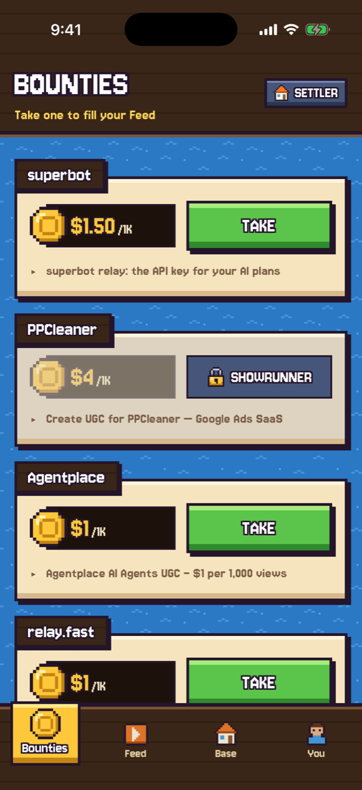
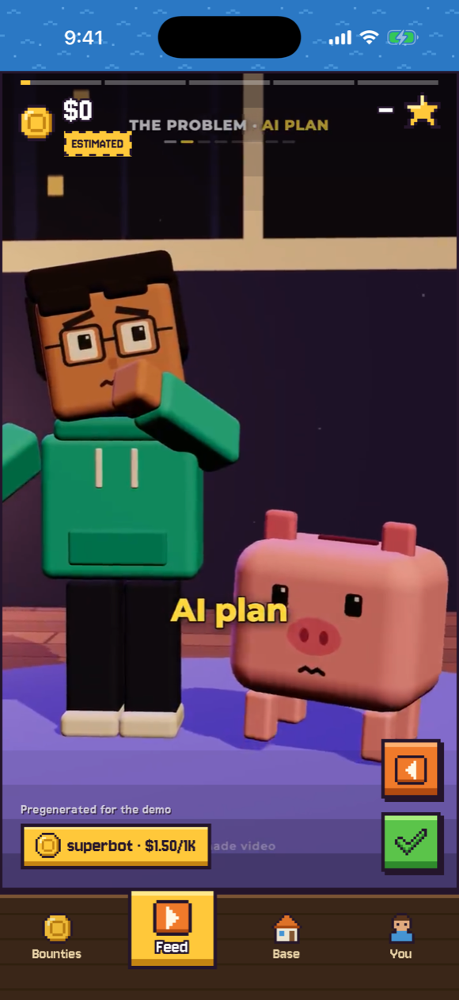
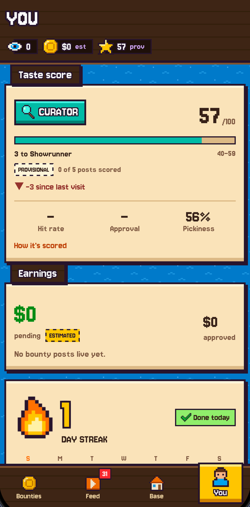
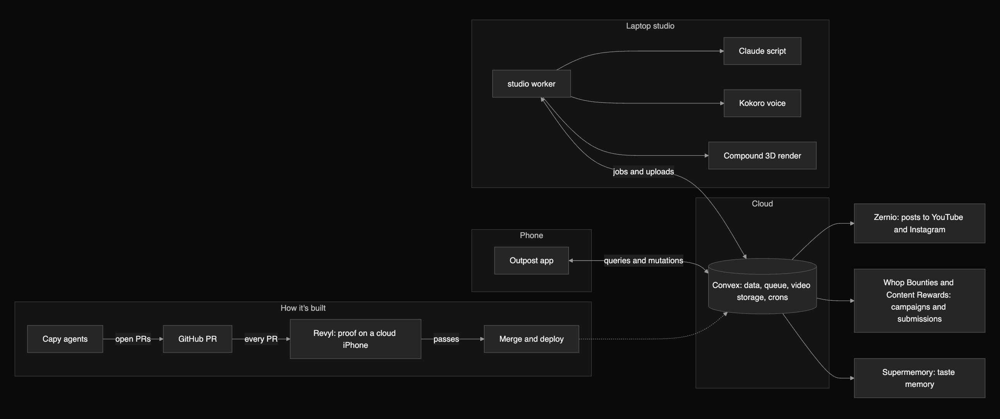
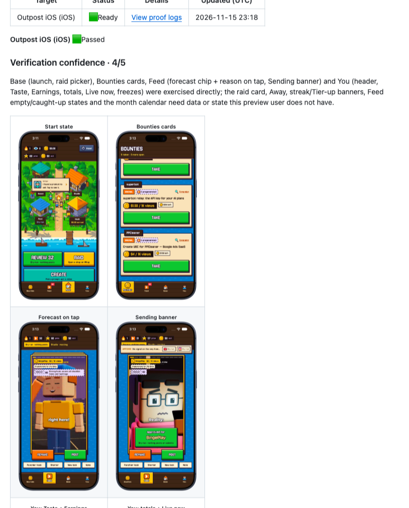
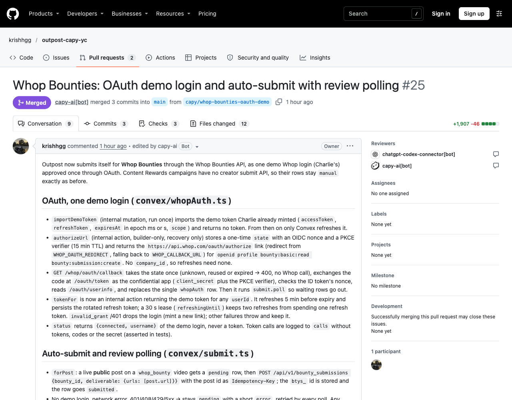
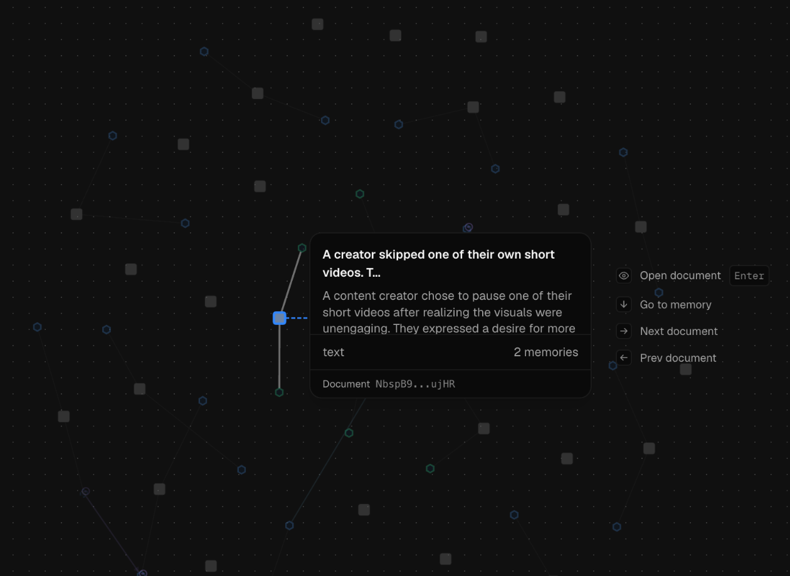

<p align="center"></p>

# Outpost

**Get paid to doomscroll.** Outpost is an iOS app where AI agents make short videos for real brand bounties, you swipe to decide which ones post, and your taste score rises or falls with the real views.

## Why

- You already judge thousands of videos a day by stopping or scrolling past. You do it for free, and the platforms keep the money.
- AI can now make endless videos for almost nothing. It still can't tell which ones people want to watch. That takes a person.
- So Outpost pays people for their taste and scores them on whether they were right.

## How it works

<table>
<tr>
<td align="center" width="33%"></td>
<td align="center" width="33%"></td>
<td align="center" width="33%"></td>
</tr>
<tr>
<td valign="top"><b>1. Take a bounty.</b> Real paid campaigns from brands on Whop. Your agents read the brief and make the videos.</td>
<td valign="top"><b>2. Swipe.</b> Left sends a video back with a reason, like "Hook too slow", and the agents remake it. Right posts it, and one tap submits it to the brand on Whop.</td>
<td valign="top"><b>3. Get scored.</b> Each post is a Hit, Solid or Miss against your usual views. Your score sets your tier, and higher tiers unlock bounties that pay more per 1K views. Approve junk and they lock again.</td>
</tr>
</table>

Nothing posts until a person swipes right. Your swipes train the agents, and real view counts train you.

| Tier | Taste score | Unlocks |
|---|---|---|
| Settler | 0+ | Bounties open to everyone |
| Curator | 40+ | $2 per 1K views bounties |
| Showrunner | 60+ | $4 per 1K views bounties |
| Tastemaker | 80+ | $6 per 1K views bounties |

## How the sponsors fit together

<p align="center"></p>

| Sponsor | What it does in Outpost |
|---|---|
| **Convex** | The whole backend: users, bounties, the Feed, the studio's job queue, video files, posting, payments and crons. The phone and the laptop studio only talk through it. |
| **Whop** | The money. Bounties come from Whop Content Rewards and Whop Bounties. Content Rewards posts are submitted with one tap, and Whop Bounties are submitted automatically with their review status tracked. |
| **Supermemory** | Taste memory. It learns your taste from why you send videos back, and the studio writes the next scripts with what it learned. |
| **Revyl** | Every pull request is built and proven on a cloud iPhone before it merges. |
| **Capy** | The agents that built it. Almost every pull request in this repo came from Capy agents, each on a `capy/` branch. |

<table>
<tr>
<td align="center" width="50%"><br><sub><b>Revyl</b>: proof of changes on a pull request, with the iPhone screens it checked</sub></td>
<td align="center" width="50%"><br><sub><b>Capy and Whop</b>: the Whop Bounties integration, built and merged by Capy</sub></td>
</tr>
</table>

The studio runs on a laptop: Claude writes each script, Kokoro voices it, Compound renders it in 3D, and the worker uploads it to Convex. Zernio posts approved videos to YouTube and Instagram and brings back the view counts.

### How Supermemory makes the agents better

Every swipe teaches the agents what you like. Supermemory is where that lesson is kept.

1. You swipe a video away and say why, like "Hook too slow" or "Visuals are boring".
2. Outpost saves the reason to your own space in Supermemory, written as a taste note: "A creator skipped one of their own short videos. Their reason: the visuals were unengaging. They want livelier visuals."
3. Supermemory turns those notes into memories about your taste and links related ones.
4. When the studio writes your next video, Claude gets what Supermemory learned about you along with the brand's brief. The remake fixes what you complained about, and every video after it starts from your taste.

<p align="center"><br><sub><b>Supermemory</b>: one creator's taste notes as a memory graph. Each note came from a swipe and holds what Supermemory learned from it.</sub></p>

## Repo map

| Path | What it is |
|---|---|
| `outpost/` | The app, backend and studio. Everything that runs is here |
| `outpost/src/` | App screens and components. Routes are in `outpost/src/app/` |
| `outpost/convex/` | Convex schema and functions |
| `outpost/studio/` | The laptop studio worker and its Compound template |
| `outpost/art/` | Python scripts that draw the pixel art |
| `outpost/assets/` | Images, village art, icons and sounds |
| `outpost/docs/` | Architecture, app, backend, integrations and demo docs |
| `.github/workflows/typecheck.yml` | CI: type-checks the app and Convex, syntax-checks the worker |
| `engagement-research.md` | Research on why short-video feeds hold attention |
| `research/` | UX research (`ux/`) and the trend research behind the video batch (`trends/`) |
| `visuals/` | Static HTML mockups and pitch visuals |

The research notes and `visuals/` are background material. The code in `outpost/` is the source of truth.

## Quick start

You need macOS with Xcode, Node 22 and a Convex account.

```sh
cd outpost
npm ci
npx convex dev                         # log in, pick a project, push functions, write .env.local
npx convex env set WORKER_SECRET <a long random string>
npx expo run:ios                       # build the dev client and run it on the simulator
```

The Feed stays empty until the studio worker runs. It needs the `claude` CLI, Compound Beta, Kokoro and `ffmpeg` on the laptop:

```sh
cd outpost
while true; do node studio/worker.mjs; sleep 3; done
```

Posting, the shop raid and taste memory each need a key on Convex. New users start in dry run, which posts nothing. See [outpost/README.md](outpost/README.md) for the full setup.

## Docs

- [outpost/README.md](outpost/README.md): running the app, the backend and the studio, and the environment variables each needs
- [Architecture](outpost/docs/architecture.md): the system end to end, the life of a video, and the data model
- [App](outpost/docs/app.md): each screen and what you can do on it
- [Backend](outpost/docs/backend.md): Convex modules, crons, scheduled jobs, posting modes and admin commands
- [Integrations](outpost/docs/integrations.md): each service, where it is used, and its status
- [Demo runbook](outpost/docs/demo-runbook.md): running the live demo
- [Studio](outpost/studio/README.md): the studio worker and its video template
