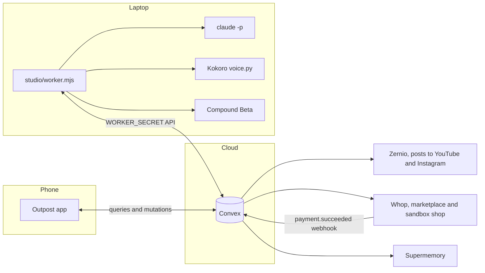

# Architecture

Outpost has three running parts:

- **The app** (`outpost/src/`). An Expo Router iOS app. It talks only to Convex.
- **Convex** (`outpost/convex/`). The backend in the cloud. It holds all data and video files, runs the Feed, schedules posts, and calls Zernio, Whop and Supermemory.
- **The studio worker** (`outpost/studio/worker.mjs`). A Node process on the builder's laptop. It takes video jobs from Convex, writes, voices and renders each one, and uploads the file back to Convex.

The phone never calls an outside service, and the laptop only makes videos. Posting, view counts, payments and taste memory all run in Convex, so they keep working while the laptop sleeps. Only new videos stop.

## Who calls what

| From | To | How | Code |
|---|---|---|---|
| App | Convex | `ConvexReactClient` on `EXPO_PUBLIC_CONVEX_URL`, live queries and mutations | `src/app/_layout.tsx` |
| Worker | Convex | `ConvexClient` on the same URL. Every call passes `WORKER_SECRET` as `key` | `studio/worker.mjs`, `convex/studio.ts` |
| Worker | Claude | Spawns `claude -p` with a JSON schema for the script | `studio/worker.mjs` (`claude()`), `studio/reel.mjs` (`SCRIPT_SCHEMA`) |
| Worker | Kokoro | A long-running `studio/voice.py` process, one JSON request per stdin line | `studio/worker.mjs` (`voice`), `studio/voice.py` |
| Worker | Compound | `compound mcp` over JSON-RPC, tools `open` and `export` | `studio/worker.mjs` (`compound`) |
| Convex | Zernio | `fetch` from internal actions | `convex/post.ts`, `convex/views.ts`, `convex/admin.ts` |
| Convex | Whop | `fetch` from internal actions. Sandbox API for the shop, public API for the Scout | `convex/whop.ts`, `convex/scout.ts` |
| Convex | Supermemory | `fetch` from internal actions | `convex/memory.ts` |
| Whop | Convex | `POST /whop/webhook` HTTP action | `convex/http.ts` |

Every outside call that Convex or the worker makes is written to the `calls` table. The `/hood` screen reads it live. See [app.md](app.md#under-the-hood-hood).

## Identity

There are no accounts. On first launch, `src/device.ts` makes a random 64-character id and keeps it in the iOS keychain through `expo-secure-store`. `src/session.tsx` calls `feed.ensureUser` with that id and the phone's time zone. Every app query and mutation takes `deviceId` and looks the user up with `userFor()` in `convex/lib.ts`.

`ensureUser` refuses new users once the `users` table holds `MAX_USERS` rows (default 5). A new user starts with:

| Field | Value |
|---|---|
| `niche` | `Notion templates for freelancers` |
| `postingMode` | `dryRun` |
| `pacePerDay` | 12 |
| `freezesLeft` | 2 |

Only the builder can change the posting mode, through the internal `admin` functions. No phone call can turn on public posting.

## The life of a video

The `videos.status` field moves through `queued`, `making`, `ready`, then `right` (posted) or `left` (sent back or skipped). `failed` is the dead end.

### 1. Queue

`refill()` in `convex/lib.ts` keeps `BUFFER` (10) videos per user in `queued`, `making` or `ready`. It runs on `ensureUser`, after every swipe, and when a video fails for good. Three other paths add a queued video:

- A left swipe with a reason adds a remake with `parentId`, `remakeReason` and maybe `remakeNote`.
- A right swipe on a Scout card adds a video with `findId`.
- Both get a `rank` that puts them just after the third ready card, so they show up within a few swipes.

### 2. Claim

The worker subscribes to `studio.queue`. That query returns up to 12 queued jobs, remakes first, then by `rank`. The worker runs up to 3 jobs at once (`WRITERS`). For each one it calls `studio.claim`, which:

- moves the video to `making` with `stage: "writing script"` and stamps `claimedAt`,
- returns the context the writer needs: the niche, the 5 newest taste notes, up to 6 lines Supermemory has learned, recent hooks to avoid, the Scout find if any, and for a remake the parent's script, voice, palette and length.

### 3. Script

`write()` in `worker.mjs` asks Claude for a script through `claude -p --model sonnet` (`WRITER_MODEL` overrides the model). The call has no tools, a 60 second timeout, and must return JSON that matches `SCRIPT_SCHEMA` in `studio/reel.mjs`: an angle, a `POV:` hook, a small sub line, 5 to 7 beats, a call to action, a caption and a title.

What the writer does depends on the job:

| Job | What happens |
|---|---|
| Fresh video | Writes on the next stock angle from `ANGLES` in `worker.mjs` |
| Scout find | Writes on the problem behind the Whop listing. The posted title and caption come from the hook and call to action |
| Remake: Hook too slow | Rewrites only the hook |
| Remake: Too long | Cuts about a third of the spoken words, and voices it faster |
| Remake: Say more | Applies the user's note |
| Remake: Wrong topic | Writes a new video on the next stock angle |
| Remake: Boring visuals | Keeps the script, moves to the next palette |
| Remake: Voice | Keeps the script, moves to the next voice and speaks faster |

### 4. Voice

The worker sets `stage: "voicing"` and sends the hook (without `POV:`), each beat and the call to action to `voice.py`. Kokoro returns a WAV and word timings. One of three deep voices is used (`am_onyx`, `am_fenrir`, `am_michael`). `ffmpeg` then lowers the pitch about a semitone and brings loudness to -16 LUFS without changing the timing.

### 5. Render

The worker sets `stage: "rendering"`. `layout()` in `reel.mjs` turns the script and word timings into a flat list of timed events. The worker writes them into the Compound project's `jobs.ts` (keeping the last 8 scenes) and calls Compound's `export`. Compound exports one scene at a time, so renders queue in the worker. The output is a 1080 x 1920 MP4.

The template the worker copies into the Compound project at start lives in `studio/template/`. For how the reel is drawn, see [`outpost/studio/README.md`](../studio/README.md).

### 6. Upload

The worker sets `stage: "uploading"`, gets an upload URL from `studio.uploadUrl`, posts the file to Convex storage, and calls `studio.finish` with the storage id, the script, voice, palette, model, length and per-step timings. `finish` moves the video to `ready`, bumps today's `made` count, and deletes the rejected parent's file if this was a remake.

A failed job calls `finish` with an `error`. The first failure puts the video back in the queue. The second marks it `failed` and refills the buffer.

### Keeping jobs alive

- Each stage update renews `claimedAt`.
- The `studio sweep` cron runs every minute. It returns any `making` video whose claim is older than 3 minutes to `queued`.
- The worker sends `studio.beat` every 10 seconds. The app treats the studio as offline when the last beat is more than 25 seconds old.
- The worker exits if Kokoro or Compound dies or stops answering, so it is meant to run in a restart loop. See [demo-runbook.md](demo-runbook.md).

### 7. Review

The Feed shows up to 12 `ready` videos from `feed.next`. The user swipes:

- **Right (POST).** `feed.swipe` marks the video `right` and adds one `posts` row per platform (YouTube and Instagram).
- **Left with a reason (REMAKE).** Marks it `left`, saves a taste note, sends the note to Supermemory, and queues a remake.
- **Left with "Just skip it".** Marks it `left` and deletes the file.

### 8. Post

Each `posts` row gets a slot from `slotFor()` in `convex/pace.ts`. A platform gets at most `pacePerDay` posts in any 24 hours, with a burst of 2 that refills one every 20 minutes. A row waits as `held` until its slot, then `post.publish` runs.

`publish` reads the row's `mode`, copied from the user when they swiped:

| Mode | YouTube | Instagram |
|---|---|---|
| `dryRun` | Nothing sent. Row becomes `dry_run` | Same |
| `private` | Posted as a private video | Skipped. Instagram has no private mode |
| `public` | Posted publicly | Posted publicly |

For a real post, Convex uploads the file to Zernio, creates the post with `publishNow: true` and the row id as `Idempotency-Key`, then polls `post.check` until the platform reports a URL. See [backend.md](backend.md#postts) for the retry and polling schedule.

### 9. Views

The `read views` cron runs `views.sync` every 20 minutes. It asks Zernio for the views on each live post from the last 14 days and keeps the higher of the old and new count, so a total never drops on screen.

## Taste memory

1. A left swipe with a reason writes a `tasteNotes` row and schedules `memory.syncNote`.
2. `syncNote` sends the note to Supermemory with the container tag `outpost_<userId>` and the note id as `customId`.
3. `memory.kick` starts a round of `memory.refresh` checks every 20 seconds, up to 15 tries. Each reads the user's documents and profile from Supermemory.
4. What Supermemory has learned is cached in the `taste` table, so neither the studio nor the app waits on Supermemory.
5. `studio.claim` passes the newest notes and learned lines to the script writer.

## The shop raid

1. The user taps RAID on the Base and starts "Open a shop". `raids.start` makes a `raids` row with three setup steps and an `offers` row for the $9 template, then schedules `whop.setup`.
2. `whop.setup` creates the product, then a one-time $9 checkout, then a `payment.succeeded` webhook if `PUBLIC_SITE_URL` is set. Each step is marked on the raid as it lands.
3. When all three steps are done the raid goes `live` and Convex polls Whop for payments every 4 seconds for 10 minutes. The Base renews that window while it is on screen.
4. A payment arrives by webhook or by poll. `raids.recordPayment` dedupes on the payment id, writes a `ledger` row, and lights the stars.

The stars are: halfway to the $25 goal, the first sale, and the full goal. All three count net cents after Whop's fees.

## Data model

All tables are in `convex/schema.ts`.

| Table | One row per | Main fields | Indexes |
|---|---|---|---|
| `users` | phone | `deviceId`, `niche`, `tz`, `postingMode`, `pacePerDay`, `drainPaused`, `freezesLeft`, `seen` (last Collect), `scoutAt` | `by_device` |
| `connections` | linked social account | `platform`, `accountId`, `handle` | `by_user` |
| `videos` | video job | `status`, `rank`, `stage`, `parentId`, `remakeReason`, `remakeNote`, `findId`, `script`, `voice`, `palette`, `model`, `storageId`, `durationS`, `timings`, `publicUrl`, `attempts`, `claimedAt`, `readyAt`, `error` | `by_user_status_rank`, `by_status` |
| `finds` | Whop product the Scout found | `whopId`, `title`, `headline`, `priceCents`, `renews`, `everyDays`, `members`, `rating`, `reviews`, `image`, `query`, `status` (`new`, `right`, `left`) | `by_user_status`, `by_user_whop` |
| `swipes` | video swipe | `videoId`, `dir`, `reason`, `dwellMs`, `day` | `by_user_day` |
| `days` | user per local day | `made`, `approved`, `remakes`, `skipped` | `by_user_day` |
| `tasteNotes` | remake reason | `text`, `reasonKey`, `videoId`, `sync` (`pending`, `synced`, `failed`), `deleted` | `by_user` |
| `taste` | user | `gen`, `busy`, `learned`, `memories` (Supermemory cache) | `by_user` |
| `posts` | video per platform | `platform`, `status`, `mode`, `providerId`, `url`, `views`, `viewsAt`, `slotAt`, `liveAt`, `checks`, `error` | `by_user_platform_slot`, `by_video`, `by_provider`, `by_status_slot` |
| `calls` | outside call | `service`, `op`, `status` (`ok`, `error`, `skipped`), `ms`, `detail` | `by_at`, `by_user_at`, `by_user_service_at` |
| `workers` | studio laptop | `name` (always `laptop`), `lastSeen`, `current` | `by_name` |
| `raids` | raid | `kind` (`shop`), `status`, `test`, `goalCents`, `netCents`, `sales`, `stars`, `steps`, `offerId`, `watchUntil`, `pollGen`, `firstSaleAt` | `by_user` |
| `offers` | thing for sale | `raidId`, `title`, `priceCents`, `whopProductId`, `checkoutId`, `purchaseUrl` | `by_checkout`, `by_product` |
| `ledger` | payment | `raidId`, `offerId`, `source` (`whop`), `externalId`, `grossCents`, `netCents`, `test`, `via` (`webhook`, `poll`) | `by_external`, `by_user` |
| `kv` | server-only value | `key`, `value`. Holds the Whop webhook URL and signing secret. No public function reads it | `by_key` |

### Status values

| Field | Values |
|---|---|
| `videos.status` | `queued`, `making`, `ready`, `right`, `left`, `failed` |
| `videos.stage` (while `making`) | `writing script`, `voicing`, `rendering`, `uploading` |
| `posts.status` | `held`, `queued`, `publishing`, `live`, `failed`, `dry_run`, `skipped` |
| `raids.status` | `setting_up`, `live`, `failed` |
| `raids.steps[].state` | `todo`, `done`, `error` |

### Stored scripts

The `script` object on a video holds `hook`, an optional `sub`, `lines` (one per beat: `say`, `label`, and optional `kind`, `items`, `value`, `unit`), `cta`, an optional `keyword`, `caption`, `title` and `angle`. Older videos have three plain lines and none of the optional fields. `toStored()` and `fromStored()` in `studio/reel.mjs` convert between this shape and the writer's `beats`.
